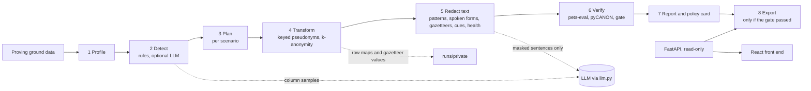

# PurposeFit

PurposeFit compiles a data release for one stated purpose. It asks who receives the data, for what purpose and who might attack it, keeps only what that purpose needs, and re-runs the proving ground's own scorer before it lets anything be exported.
Two recipients of the same data get two different plans: the transcripts, columns and coarseness all follow the purpose.
Built for the Since AI Hackathon 2026, TrustED PETs Transformer challenge, on the synthetic TrustED proving ground only.

## The scenario: CS-S1

`customer_service`, scenario CS-S1: an external analytics vendor mines contact reasons from support transcripts. The vendor's staff and model logs can see all text. The plan for CS-S1 releases two tables (conversations and turns), pseudonymises the join key, drops every direct identifier the tasks do not need, and redacts names, ids, contact details, secrets and health mentions in the transcripts. The same data for CS-S2 (an internal intent model team) and CS-S3 (aggregate volumes only) gets different plans, shown in the results below.

## Architecture



Every stage reads the previous stage's file and writes `runs/<run_id>/NN_*.json`. The design is in `docs/ARCHITECTURE.md`, the API in `docs/API_CONTRACT.md`.

## Run it

Requires [uv](https://docs.astral.sh/uv/) and Python 3.11. The proving ground is not in this repo: unzip it into `vendor/proving_ground/`. Put `PURPOSEFIT_HMAC_KEY=<output of openssl rand -hex 32>` and `GEMINI_API_KEY=<your key>` in `.env` (see `.env.example`); the key is optional with `--no-llm`.

```bash
uv sync
uv run python scripts/fetch_gazetteer.py
make test
make demo      # final runs for CS-S1, CS-S2, CS-S3 and the AI-off run, fixtures, then the server on port 8000
make serve     # only the server (http://127.0.0.1:8000)
```

One run by hand: `scripts/final_run.sh CS-S1` (add `nollm` for the AI-off run). With Docker, mount the runs and the proving ground and pass the key:

```bash
docker build -t purposefit .
docker run -p 8000:8000 -e PURPOSEFIT_HMAC_KEY=... -v "$PWD/runs:/app/runs" -v "$PWD/vendor:/app/vendor" purposefit
```

## Results

Self-assessment from `pets-eval` 1.0.0, CS-S1, whole release including the eval split. These are not the official judging scores. Baselines are the proving ground's B0 (drop direct identifiers), B2 (classic disclosure control with regex redaction) and B2-k (B2 plus suppression to k of 5).

| CS-S1 | Privacy | Utility | Composite | Worst risk |
| --- | --- | --- | --- | --- |
| B0 | 0.2222 <!--c:lb.b0_CS-S1.privacy--> | 1.0000 <!--c:lb.b0_CS-S1.utility--> | 0.3438 <!--c:lb.b0_CS-S1.composite--> | 1.0000 <!--c:lb.b0_CS-S1.worst_risk--> |
| B2 | 0.3126 <!--c:lb.b2_CS-S1.privacy--> | 0.7475 <!--c:lb.b2_CS-S1.utility--> | 0.4250 <!--c:lb.b2_CS-S1.composite--> | 1.0000 <!--c:lb.b2_CS-S1.worst_risk--> |
| B2-k | 0.4952 <!--c:lb.b2k_CS-S1.privacy--> | 0.7475 <!--c:lb.b2k_CS-S1.utility--> | 0.5849 <!--c:lb.b2k_CS-S1.composite--> | 0.8286 <!--c:lb.b2k_CS-S1.worst_risk--> |
| **PurposeFit** | 0.9946 <!--c:lb.final-CS-S1.privacy--> | 0.9720 <!--c:lb.final-CS-S1.utility--> | 0.9842 <!--c:lb.final-CS-S1.composite--> | 0.0086 <!--c:lb.final-CS-S1.worst_risk--> |

The release gate passes for CS-S1: no direct identifier retained, no quasi-identifier released, every shared risk component lower than B2-k's, identifying text leakage at most 0.10.

### AI off gives the same result

Every release is also produced and verified with the LLM switched off (`--no-llm`: rules-only column labels, no health flags).

| CS-S1 | Privacy | Utility | Composite | Worst risk |
| --- | --- | --- | --- | --- |
| LLM on (`final-CS-S1`) | 0.9946 <!--c:lb.final-CS-S1.privacy--> | 0.9720 <!--c:lb.final-CS-S1.utility--> | 0.9842 <!--c:lb.final-CS-S1.composite--> | 0.0086 <!--c:lb.final-CS-S1.worst_risk--> |
| LLM off (`final-CS-S1-nollm`) | 0.9946 <!--c:lb.final-CS-S1-nollm.privacy--> | 0.9728 <!--c:lb.final-CS-S1-nollm.utility--> | 0.9846 <!--c:lb.final-CS-S1-nollm.composite--> | 0.0086 <!--c:lb.final-CS-S1-nollm.worst_risk--> |

The scorer does not count health mentions, so the privacy score does not move; the health numbers are below.

### Three recipients, three plans

| Scenario | Recipient | Released | Privacy | Utility | Composite |
| --- | --- | --- | --- | --- | --- |
| CS-S1 | External analytics vendor | conversations, turns (text redacted) | 0.9946 <!--c:lb.final-CS-S1.privacy--> | 0.9720 <!--c:lb.final-CS-S1.utility--> | 0.9842 <!--c:lb.final-CS-S1.composite--> |
| CS-S2 | Internal intent model team | conversations, turns (text redacted, sentiment and CSAT kept) | 0.9946 <!--c:lb.final-CS-S2.privacy--> | 0.9626 <!--c:lb.final-CS-S2.utility--> | 0.9798 <!--c:lb.final-CS-S2.composite--> |
| CS-S3 | Aggregate volumes | conversations only (generalised, k of at least 5) | 1.0000 <!--c:lb.final-CS-S3.privacy--> | 1.0000 <!--c:lb.final-CS-S3.utility--> | 1.0000 <!--c:lb.final-CS-S3.composite--> |

### Text redaction

On the customer_service train split the rule layers leave an identifying leakage of 0.0086 <!--c:redact.train_leakage--> with span precision 0.9876 <!--c:redact.train_precision-->. With only the public DVV name lists and no controller values the leakage is 0.1187 <!--c:redact.dvvonly_leakage--> (precision 0.9550 <!--c:redact.dvvonly_precision-->): the controller's own customer and agent names do most of the name work in this synthetic data. Spoken national ids read out in chunks over several turns are joined per speaker and checked for the id shape and a plausible date: national-id leakage on the train split fell from 11.5% <!--c:redact.nationalid_before--> to 5.3% <!--c:redact.nationalid_after-->. The ablation per layer is in `docs/reports/phase5_redact.md` and in the verify stage.

### Health mentions (reported separately)

The scorer's identifying-leakage metric does not count health mentions, but a transcript sent to an external vendor is a special-category risk. A cue-word prefilter and an LLM flag health sentences. The LLM only ever sees text in which the rule layers' spans are already replaced by placeholders. Train-split leakage of health mentions: 95.6% <!--c:health.train_before--> without the layer, 0.0% <!--c:health.train_after--> with it, with health-span precision 1.00 <!--c:health.train_precision-->. On the whole CS-S1 release the rate is 0.0% <!--c:health.release_after-->. Cost on the full train split: 8 <!--c:health.train_calls--> model calls with 11,575 <!--c:health.train_prompt_tokens--> prompt and 4,163 <!--c:health.train_output_tokens--> output tokens; the CS-S1 release run used 10 <!--c:health.release_calls--> calls, answered from the cache.

### Detection of sensitive fields

Column labels are scored against the proving ground's field catalogue over its nine domains (475 columns). The four held-out domains were not used to tune the rules.

| Detector | Held-out macro-F1 | All nine, macro-F1 | All nine, sensitive recall |
| --- | --- | --- | --- |
| B1 (proving ground rules) | 0.63 <!--c:detect.b1.heldout.macro_f1--> | 0.65 <!--c:detect.b1.all.macro_f1--> | 0.73 <!--c:detect.b1.all.sensitive_recall--> |
| PurposeFit rules only | 0.72 <!--c:detect.rules.heldout.macro_f1--> | 0.86 <!--c:detect.rules.all.macro_f1--> | 0.90 <!--c:detect.rules.all.sensitive_recall--> |
| PurposeFit rules and LLM | 0.75 <!--c:detect.llm.heldout.macro_f1--> | 0.86 <!--c:detect.llm.all.macro_f1--> | 0.98 <!--c:detect.llm.all.sensitive_recall--> |

### The unseen dataset

`pets_submission/unseen_field_labels.csv` labels the 26 columns of the unseen export. Notable finding: column c20 holds an unkeyed SHA-256 hash of the national id in c05. The detector recomputes the hash of c05 values and finds a full match, so c20 is labelled a direct identifier (an unkeyed hash of a small space can be reversed by enumeration). Column c14 is zero exactly where the sensitive column c13 is empty, so it follows c13's label.

### Runtime

CS-S1, whole dataset (140,345 turns), one laptop, four runs in parallel (so the times are higher than a single run). Seconds per stage:

| Stage | LLM on | LLM off |
| --- | --- | --- |
| Profile | 3.4 <!--c:timing.final-CS-S1.profile--> | 3.4 <!--c:timing.final-CS-S1-nollm.profile--> |
| Detect | 2.7 <!--c:timing.final-CS-S1.detect--> | 1.7 <!--c:timing.final-CS-S1-nollm.detect--> |
| Plan | 1.3 <!--c:timing.final-CS-S1.plan--> | 1.4 <!--c:timing.final-CS-S1-nollm.plan--> |
| Transform | 2.6 <!--c:timing.final-CS-S1.transform--> | 2.6 <!--c:timing.final-CS-S1-nollm.transform--> |
| Redact | 177.0 <!--c:timing.final-CS-S1.redact--> | 162.5 <!--c:timing.final-CS-S1-nollm.redact--> |
| Report | 1.1 <!--c:timing.final-CS-S1.report--> | 1.3 <!--c:timing.final-CS-S1-nollm.report--> |
| Verify | 18.5 <!--c:timing.final-CS-S1.verify--> | 21.1 <!--c:timing.final-CS-S1-nollm.verify--> |

## Privacy safeguards in the pipeline

- Masked LLM payloads: the health layer runs after the rule layers and receives text with detected spans replaced by typed placeholders. A test records every payload and checks that no detected identifier appears in it. Column labelling sends samples of column values, not whole tables.
- Per-recipient keys: the pseudonym key is derived per scenario as HMAC(master key, "purposefit-v1|" plus the scenario id), so two recipients cannot join their releases. The plan records the derived key id, never a key.
- Server-side gate: the export endpoint refuses (409, naming the failing checks) unless the release gate passed. The export holds only the released tables, the plan table and the policy card: no row maps, spans, caches, keys or originals.
- Row maps, gazetteer values and caches stay in `runs/private/` and `runs/cache/`; the API never serves them. The one exception is `pets_submission/customer_service/`, whose row maps the organisers ask for (synthetic data, used only for scoring).
- Logs hold ids, counts and timings only; tests check this. LLM calls go through one module, are cached and logged by call id, and can be switched off.
- Each run's `00_manifest.json` records the git hash, model names, a hash of the LLM answers used, the derived key id and the stage timings.
- The policy card (`07_policy_card.json` and `.md`) names the pseudonymisation secret by key id only, the pseudonymisation domain (the named recipient) and the additional information (row maps and gazetteer values) held by the controller, in the terms of EDPB Guidelines 01/2025.

## Limitations

- Pseudonymised data is still personal data (GDPR Recital 26).
- k-anonymity limits singling out on the stated quasi-identifiers only; it does not stop attribute inference inside a uniform group.
- Localhost only, no authentication: the API binds to 127.0.0.1 by default and has no login. Do not expose it on a network.
- The Text view shows the original synthetic text next to the protected text for the demo. With real data that endpoint would need access control or removal.
- Places, dates and organisations in free text are not redacted yet (leakage 0.88 to 0.96 for those labels); there is no NER layer. Some spoken national ids still leak (see the national-id rate above), for example ids spoken with letter names inside one turn. Health mentions without a cue word are missed.
- Names rely on the controller's own records; the public lists alone leave the leakage given above.
- The headline numbers are the scorer's self-assessment. Starting runs from the API (POST) and file upload are not built.
- The Docker image has not been built or run in this environment.
- LLM answers vary slightly between fresh calls even at temperature 0; the run manifest records a hash of the answers used so a rerun with the cache can be checked.

## Security checks

`ruff`, `bandit` and `pytest` run in CI on every push; `pip-audit` reports no known vulnerabilities; `gitleaks` over the full history found no leaks; a security review of the backend found no high-confidence issues. Run `make lint`, `make audit` and `make test` locally.

## Licences and attribution

- Finnish first-name and surname lists: Digi- ja väestötietovirasto (DVV), "Väestötietojärjestelmän suomalaisten nimiaineistot", https://www.avoindata.fi/data/en/dataset/none , licensed under [CC BY 4.0](https://creativecommons.org/licenses/by/4.0/). Downloaded by `scripts/fetch_gazetteer.py`; file names, dates and checksums are in `data/gazetteer/SOURCES.json`. We use the lists unmodified as a lookup source.
- TrustED proving ground and its data: see its own `LICENSE` and `LICENSE-DATA.md` (data CC BY 4.0, Since AI ry); not redistributed here except the protected release and the turn text shown in `web/fixtures/` and `pets_submission/`, which are derived from it.
- This repository's own code has no licence file yet; the repository owner decides.

## Verifying the numbers

Every number quoted above carries a hidden marker. `make verify-claims` recomputes each from the run files and the leaderboard and fails if any differs; CI checks the README against the committed snapshot `docs/claims.json`.
